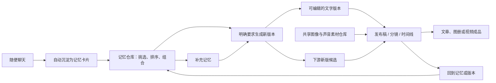

# 记忆驱动的作品生产流程

## Summary

把随意聊天自动沉淀为可组合的记忆，让用户主动从记忆生成和比较文字版本，再按需把某一版本发展为发布稿、分镜、时间线及文章或视频成品。图像和声音作为同一作品内可复用的共享素材存在；版本升级始终由用户确认，并以新候选代替对旧成果的直接改写。所有创作操作都可在对话中用自然语言完成，产品不应再通过不断增加按钮来承载流程。

---

## Problem Frame

创作常常从零散聊天、片段化想法和当下感受开始。若这些内容只留在对话里，用户后来想写成文章、故事或视频时，需要重新回忆和整理；若每一次补充又直接覆盖成稿，创作过程则会丢失可比较的选择。

现有文字、图像、声音、分镜与时间线能力已经可以制作不同形态的作品，但它们需要一条共同的上游路径，让用户能从记忆回到文字、再带着合适的文字版本走向下游，并随时安全地回溯。若每个操作再增加一个专属按钮，工作区会随着流程变长而变得难以理解；用户应能在当前对话中直接表达意图，由助手解释、执行或在必要时追问。

图示概括创作循环；下方文字要求为准。

---

## Actors

- A1. 创作者：通过聊天留下想法，选择哪些记忆组成下一版文字，并决定是否把新版本带入下游作品。
- A2. 创作助手：将已提交聊天沉淀为记忆，依据用户明确选择的记忆生成可编辑文字版本，并在版本变化时说明受影响的下游内容。
- A3. 作品工作区：承载发布、图像、声音、分镜、时间线和输出；保留各成果引用的文字版本和素材关系。

---

## Key Flows

- F1. 从聊天积累记忆
  - **Trigger:** 创作者提交一条文字聊天。
  - **Actors:** A1, A2
  - **Steps:** 聊天保存 → 内容进入记忆仓库 → 创作者可在之后筛选、重排或组合卡片。
  - **Outcome:** 创作者不必在聊天当下判断一段内容是否值得保存，之后仍能找回并使用它。
  - **Covered by:** R1–R3

- F2. 从记忆生成文字版本
  - **Trigger:** 创作者在记忆仓库选定并排序若干记忆后，明确要求生成新版本；该要求可以来自对话或已有工作区操作。
  - **Actors:** A1, A2
  - **Steps:** 系统保留本次记忆组合的快照 → 生成一份可编辑文字版本 → 创作者查看、比较和选择继续使用的版本。
  - **Outcome:** 新想法成为新版本，而不是覆盖此前文章或故事。
  - **Covered by:** R4–R7

- F3. 把文字版本发展为作品
  - **Trigger:** 创作者希望把某一文字版本制作成发布内容、配图、声音或视频。
  - **Actors:** A1, A3
  - **Steps:** 创作者选择文字版本作为当前创作来源 → 按需进入发布、分镜或时间线 → 从共享素材仓库选择或修改图像与声音 → 输出文章、图册或视频。
  - **Outcome:** 不同输出形态都能追溯到自己的文字版本，同时共用同一作品的素材资源。
  - **Covered by:** R8–R11

- F4. 回溯并提出下游更新候选
  - **Trigger:** 创作者在发布、分镜或时间线中返回记忆仓库，补充记忆并生成新文字版本。
  - **Actors:** A1, A2, A3
  - **Steps:** 系统指出仍引用旧文字版本的下游内容 → 创作者逐项选择保持旧版或请求更新 → 被请求更新的分镜或时间线根据新文字形成候选 → 创作者比较后采用或保留原作。
  - **Outcome:** 创作者能沿着作品链路返回上游继续思考，同时不丢失已完成的旧成果。
  - **Covered by:** R12–R15

---

## Requirements

**记忆的沉淀与组合**

- R1. 所有已提交并保存的文字聊天都必须自动沉淀为创作者可访问的记忆卡片；用户不需要逐条执行保存操作。
- R2. 记忆仓库必须支持创作者查看、筛选、选择和排序自己的记忆卡片，以便把零散片段组成一次创作输入。
- R3. 记忆卡片保留其聊天来源与原文。归档或整理卡片不得让已处理内容被重复自动收录。
- R4. 只有创作者明确要求生成新版本后，系统才可基于记忆组合生成新的文字版本；该指令可以在对话中以自然语言提出，也可通过已有工作区操作表达。聊天、勾选或调整卡片顺序本身不得自动生成正文。

**文字版本与作品来源**

- R5. 每个文字版本必须保留当时使用的记忆组合及其顺序，并与同一作品中的其他文字版本并列可查看和比较。
- R6. 添加、移除或重新组织记忆后生成的文字必须创建新的版本，不能覆盖已有版本。
- R7. 创作者可以把任一文字版本设为当前创作来源；设定来源只改变后续新建内容的默认输入，不得自动改写既有下游成果。

**共享素材与多形态输出**

- R8. 图像和声音继续作为同一作品内的共享素材保存在各自素材仓库中，可被不同文字版本的下游成果反复查找、采用和修改。
- R9. 某个发布稿、分镜、时间线或成品可以记录其当前使用的文字版本与素材引用；这种引用不得把共享素材复制成不可编辑的孤立副本。
- R10. 创作者可以从文字版本按需进入发布、分镜和时间线，并从同一作品输出文章、图册、声音化作品或视频；这些形态不是彼此排斥的终点。
- R11. 修改或重新生成图像、声音等素材时，素材仓库保留原始资产和可恢复的历史；文字版本变化不应使共享素材消失。

**回溯、更新与候选采用**

- R12. 发布、分镜和时间线都必须提供回到记忆与文字版本的路径，使创作者可在下游创作过程中补充记忆并生成新版本。
- R13. 新文字版本出现后，系统必须识别仍引用旧版文字的下游内容，并让创作者逐项决定保持旧版或请求更新；不得自动切换引用版本。
- R14. 当创作者请求用新文字更新分镜或时间线时，系统必须生成一份独立的新版候选供比较和取舍，不得直接修改原分镜、原时间线或已完成成品。
- R15. 创作者采用新版候选后，原文字版本、原分镜、原时间线、原成品和共享素材仍须可查看、继续编辑或再次采用；取消、关闭或生成失败时，原作保持不变。

**自然语言操作与界面克制**

- R16. 创作者必须能够在任一创作对话中用自然语言执行本流程的操作，包括查找和组合记忆、生成或切换文字版本、选择要更新的下游内容、请求分镜或时间线候选、查找或采用共享素材，以及进入所需工作环节；信息不足或指令存在歧义时，助手应在对话中追问。
- R17. 本范围不得为上述操作新增专属按钮。界面应复用已有入口和当前上下文，把高频创作意图交由自然语言对话处理；付费生成、授权及其他既有明确确认边界继续保留。

---

## Acceptance Examples

**分期验收说明（2026-10-11）：** [当前实施计划](../plans/2026-10-11-001-feat-memory-driven-production-plan.md)只完成 AE3 的历史与素材引用保留部分。“自动显示素材最新修改”的跨预览解析、素材头清单和重新导出提示列入该计划的 [Deferred / 下一份计划范围](../plans/2026-10-11-001-feat-memory-driven-production-plan.md#deferred-to-follow-up-work)，尚未实施；不因此把 AE3 标为全部完成。当前验收证据与缺口见 [QA](../qa/2026-10-11-memory-driven-production.md)。

- AE1. **Covers R1–R4.** Given 用户连续聊了几段关于童年雨天的零散记忆，when 对话被保存且用户随后打开记忆仓库，then 这些内容以可选卡片出现；用户重新排列三张卡片时不自动生成文章，只有明确说出「用这些记忆生成新版本」或通过已有操作提出同一要求后才出现新文字草稿。
- AE2. **Covers R5–R7.** Given V1 使用三张记忆卡片，when 用户补入第四张卡片并点击生成，then 系统创建可比较的 V2，V1 的正文和记忆快照保持不变；用户把 V2 设为当前来源时，既有发布稿不被自动改写。
- AE3. **Covers R8–R11.** Given 同一作品已有 V1 的发布稿和一组图片、声音素材，when 用户以 V2 继续制作视频，then 他仍能在素材仓库找到并选用这些素材；在 V2 中修改素材后，原资产和既有使用关系仍可恢复。
- AE4. **Covers R12–R14.** Given 用户在 V1 的时间线中发现文字需要补充，when 他返回记忆仓库加入新记忆并生成 V2，then 系统列出该时间线仍使用 V1，并由用户决定是否请求 V2 的时间线候选；原时间线不被直接替换。
- AE5. **Covers R14–R15.** Given 系统已基于 V2 生成新的分镜候选，when 用户不采用该候选或候选保存失败，then V1 的分镜、时间线、成品和共享素材均保持可用；when 用户采用候选，原版仍可切换和继续编辑。
- AE6. **Covers R16–R17.** Given 用户正在查看一条旧时间线，when 他在对话中说「回到记忆，加入刚才关于雨声的那段，再用新版本做一份分镜给我比较」，then 助手在当前上下文完成回溯、组合与候选请求，或在必要处询问一个澄清问题；页面不要求增加这条链路的专属按钮。

---

## Success Criteria

- 用户可以把一次随意聊天中的片段，经过主动组合，发展为可比较的多版文字和多种作品成品，而不需要重新讲述或复制素材。
- 用户能清楚知道每个下游内容正在使用哪个文字版本，并能选择是否升级，而不会遭遇自动覆盖。
- 用户可从任意下游阶段返回记忆继续创作；一次回溯不会损失旧文字、旧分镜、旧时间线或素材。
- 用户可以通过自然语言完成创作链路中的操作，无需学习或寻找越来越多的专属按钮。
- 后续规划无需重新决定记忆生成边界、版本更新权限、素材共享范围和下游候选采用规则。

---

## Scope Boundaries

- 不因聊天保存、勾选记忆或切换版本而自动生成新的文字、图像、声音或视频。
- 不用新版文字直接覆盖已完成的发布稿、分镜、时间线或成品。
- 不重建图像和声音素材仓库；本需求只规定它们在同一作品中的共享与引用关系。
- 不要求用户在每次创作时预先决定最终只做文章或只做视频；同一作品可按需输出多种形态。
- 不改变付费生成、报价和确认的既有边界；版本切换与候选比较本身不得触发付费生成。
- 不以新增按钮作为记忆、版本、回溯或更新操作的主要交互方案。

---

## Key Decisions

- **聊天即记忆。** 所有已保存聊天自动沉淀，降低“要不要保存”的打断感。
- **显式生成版本。** 记忆的整理是自由探索，只有用户决定生成时才消耗创作生成能力并产生草稿。
- **版本是文字和记忆的历史。** 新记忆组合产生新版本，保留每次创作选择，而不把版本当作对旧稿的覆盖操作。
- **素材在作品内共享。** 图像和声音从素材仓库反复取用；下游成果保存的是引用和采用关系，而不是封闭的素材副本。
- **下游更新由用户逐项决定。** 当前文字版本只作为后续创作的默认来源，已有成果是否升级由用户控制。
- **更新生成候选而非修补旧作。** 当文字实质变化时，以新的分镜或时间线供比较，比在旧剪辑上自动替换内容更安全、更容易取舍。
- **对话是操作入口。** 用户可以直接说出想做的事；工作区提供上下文与结果，而不把每一步拆成新的按钮。

---

## Dependencies / Assumptions

- 本需求扩展既有 `writing-memory-warehouse`、`independent-text-versions`、`publishing-workspace`、素材仓库和时间线能力，不取代它们既有的用户归属、素材历史、付费确认或非破坏编辑约束。
- “共享素材”限定为同一作品内可复用，不改变不同作品之间的素材与用户归属隔离。
- 规划阶段需要核对现有发布版本与故事版本的关系，确保本需求的“文字版本”在界面中具有一致、可理解的名称和切换规则。
