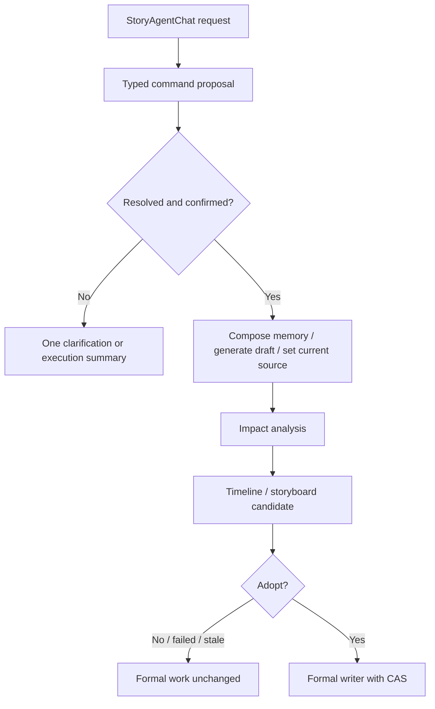

# feat: Add memory-driven production flow

## Summary

Extend the Story-centered editor so a memory-derived text draft can become the Story's current text source, report which downstream work still depends on an older source, and produce non-destructive timeline/storyboard candidates that the creator explicitly adopts. A thin natural-language command layer then exposes the flow through chat.

Delivery is phased so each phase ends with independently verifiable behavior. Server capabilities land first and are tested through tRPC; the conversation layer is built on top of them last.

---

## Problem Frame

Chats already become memory cards and can generate independent text drafts, but nothing records which draft is the current creative source or which downstream work depends on it. Publishing versions, storyboard/timeline state, and text drafts use separate identities, so a new draft cannot report its impact or produce a safe replacement candidate. The creator also wants to drive this by conversation rather than new feature-specific buttons, which requires a permission-checked command boundary instead of model output writing directly to persistence.

---

## Requirements

- R1–R4. Preserve automatic post-save chat capture, account isolation, memory provenance, explicit generation intent, and no generation from selecting or reordering cards.
- R5–R7. Preserve memory snapshots per draft; add a Story-scoped current text source that never overwrites downstream work by itself.
- R8–R11. Materials stay shared within a Story with recoverable history. This plan only guarantees that existing material references survive candidate creation/adoption; live newest-revision resolution is a follow-up plan.
- R12–R15. Return from downstream work to memory/text, see exact impacted work, and create/adopt/discard non-destructive candidates with conflict protection.
- R16–R17. Every new capability is reachable by chat; no new workflow-specific buttons; paid, ambiguous, and destructive actions keep explicit confirmation.

**Origin actors:** A1 (creator), A2 (creative assistant), A3 (production workspace).
**Origin flows:** F1–F4. **Acceptance examples:** AE1–AE6 (AE3 partially; see Scope).

---

## Scope Boundaries

- Never auto-generate text, image, sound, video, export, or any paid job from memory capture, source selection, navigation, version switching, or material edits.
- Never overwrite a formal publishing draft, storyboard, timeline, or finished product with new text.
- Do not rebuild the image/sound libraries, weaken Story/user checks, or copy asset bytes into text versions.
- Do not remove existing verified controls. New capability must be reachable by chat and must not add a new set of dedicated buttons.
- Publishing stays on its existing explicit text-adoption path; in this plan it is only reported as an impacted item, not a candidate target.

### Deferred to Follow-Up Work

- **Live shared-material resolution (separate plan):** cross-media material reference contract, newest-revision resolution in all live previews, material-head manifests, and "export source changed, re-export" status. Kept out because it changes every existing preview and needs image, visual-asset, and audio version models unified first; the core flow does not depend on it.
- Wiring the command protocol into creative-chat surfaces other than `StoryAgentChat`.
- Treating every free-form chat message as an action without an explicit command/proposal boundary.
- Cross-Story material reuse; automatic paid regeneration or export.

---

## Key Technical Decisions

Units cite these as **KD1–KD7** instead of restating them.

- **KD1 Three distinct identities.** `TextDraftVersion` is the text/memory fact source; publishing `vN` is the publication projection; storyboard/timeline candidates have their own IDs. Explicit, separately named lineage fields link them. Never reuse one ID for another, never infer lineage from labels or the active `vN`. `FinishedProductVersion.textVersionId` keeps meaning "publishing version".
- **KD2 Ownership and CAS everywhere.** Every read and write is scoped by `storyId` + `userId` at both repository and router. Every mutation carries an expected revision/version and an operation token; stale revisions and forged IDs are rejected with no data exposed.
- **KD3 Current source is a pointer, not an overwrite.** Selecting a draft only changes the default input for future work. Downstream records keep an immutable source draft ID + content fingerprint. Records created before lineage existed are `legacy/unknown`, never guessed, and are not offered automatic candidates.
- **KD4 Candidates live outside the Story body.** One candidate targets exactly one formal aggregate (one timeline or one storyboard). It is reused only if its input fingerprint (target, source fingerprint, expected formal revisions) still matches; any drift makes it `stale`. Adoption goes through that aggregate's existing authoritative writer and CAS; the candidate is marked `adopted` only after the writer commits.
- **KD5 Candidates are structural only.** Generating a candidate never renders media. Existing material references are carried over unchanged. Paid generation keeps its existing confirmation path.
- **KD6 Unknown outcomes never auto-retry.** Model/worker unknown or failed results become inspectable lifecycle states; duplicate operation tokens never submit a second generation.
- **KD7 Chat is a typed command protocol.** The model only produces a proposal validated against a command schema; only server commands mutate. An unambiguous imperative may directly run safe, idempotent actions (lookup, focus, text generation, source selection, candidate creation). Adoption, paid, destructive, or payload-changed commands need a confirmation bound to the exact resolved payload, user/session, expected revisions, and expiry, re-validated before dispatch. Ambiguity returns one clarification and no mutation.

---

## Context & Patterns

- Memory capture: `server/services/chatMemoryWarehouse.ts`, `server/repositories/memoryCards.ts` (post-save mirroring, isolation, idempotency, no archive resurrection).
- Draft history: `shared/textDraftHistory.ts`, `server/services/textDraftHistory.ts`, `server/routers/textDrafts.ts` (immutable card snapshots, `operationToken`, Story-revision CAS, generation vs adoption).
- Publishing: `shared/publishingDraft.ts`, `server/services/publishingPersistence.ts`.
- Formal writers with CAS: `server/repositories/timelines.ts` (`updateStoryTimeline`, `expectedVersion`), `server/services/publishingVideoStoryboardPersistence.ts` (preview → `confirmPublishingVideoStoryboard`, `expectedRevision`), `server/services/editingTransitionWorkflow.ts`.
- Chat command routing: `client/src/features/creationEditor/editingChatCommands.ts`, `client/src/features/storyAgent/selectionSubmissionRouter.ts`, `server/routers/storyAgent.ts`.
- Learnings: Story is the only aggregate (`docs/solutions/2026-06-13-故事为唯一单位-镜头按storyId.md`); candidate/adopt rules (`docs/plans/2026-08-08-001-feat-publishing-video-storyboard-plan.md`); centralized chat routing (`docs/plans/2026-08-31-002-feat-selection-scoped-chat-editing-plan.md`); single main-repo dev server and data store (`docs/solutions/2026-06-13-多worktree环境数据分裂收敛.md`).

---

## Delivery Phases

| Phase | Units | Exit criteria (verifiable without new UI) |
|---|---|---|
| 0 | Spike | Candidate payload shape and confirmation storage decided and written into U3/U4 |
| 1 | U1 → U2 → U3a (timeline) | AE1, AE2, AE4, AE5 pass via tRPC router tests; one migration `0030` |
| 2 | U3b (storyboard) ∥ U4 (chat commands) | Storyboard candidates pass; AE6 passes via command router tests |
| 3 | U5 → U6 | AE1–AE6 pass in the browser on the main repo; ledger updated |

Phase 1 must be complete before Phase 2 starts. In Phase 2 the two tracks touch disjoint files, but they share the main-repo dev server for browser checks; only one agent verifies in the browser at a time.

---

## Implementation Units

Each unit lists **Must-pass** tests (the gate for moving on) and **Also cover** tests.

### Phase 0. Spike (half a day, read-only)

- Read the timeline codec behind `updateStoryTimeline` and the storyboard payload consumed by `confirmPublishingVideoStoryboard`. Decide the candidate `proposal` shape: prefer storing the exact payload each formal writer already accepts, so adoption is a pass-through.
- Check whether the confirmation receipt in KD7 can reuse the existing `operationToken` pattern plus the paid-generation confirmation path. Only plan a new receipt table if neither binds payload + session + expiry.
- Write both decisions into U3 and U4 below before starting U1.

**Spike decisions (2026-10-11):** Current-source metadata belongs to the existing protected Story body and uses Story CAS, avoiding a second authority. Migration `0030` stores candidates and their immutable source lineage outside that body. Local persistence must load the new collection as well as write it.

### U1. Text-source lineage and impact analysis

**Goal:** A Story-scoped current-text-source pointer and a read-only impact query over publishing, timeline, storyboard, and finished-product records. **KD1, KD2, KD3.**
**Requirements:** R5–R7, R13; AE2, AE4. **Dependencies:** none.

**Files:**
- Create: `shared/textSourceLineage.ts`, `server/repositories/textSourceLineage.ts` (+ `.test.ts`), `server/routers/textSourceLineage.ts`, `server/routers.textSourceLineage.test.ts`
- Modify: `shared/textDraftHistory.ts`, `shared/publishingDraft.ts`, `shared/finishedProductVersion.ts`, `server/routers/index.ts`
- Migration: `drizzle/0030_text_source_lineage.sql` (also holds U3's candidate table), `drizzle/schema.ts`, `drizzle/meta/0030_snapshot.json`, `drizzle/meta/_journal.json`

**Approach:**
- `setCurrentTextSource(storyId, draftId, expectedRevision)` accepts only a ready draft and leaves publishing `activeVersionId` untouched.
- Downstream source snapshot = `{ textDraftId, contentFingerprint } | { kind: "legacy_unknown" }`.
- `getImpact(storyId)` returns each node with a stable `{ targetKind, targetId }`, its source fingerprint, and a group: `stale` / `current` / `legacy_unknown`.
- Write contract tests first so old publishing and finished-product snapshots still parse.

**Must-pass:**
- Selecting a draft sets the current source and leaves publishing `activeVersionId` unchanged.
- After a new source is selected, a publishing record and a finished product on the old source appear as two distinct `stale` nodes.
- Legacy records normalize to `legacy_unknown`.

**Also cover:** forged Story/user/draft IDs rejected; stale expected revision rejected; a source or downstream revision change invalidates an earlier impact result.

### U2. Memory composition as a reusable server operation

**Goal:** Lift selected-card generation out of the modal-only path into one server operation that both the existing UI and the U4 command layer call. It creates a new immutable draft in the current Story. Selecting the new draft as the current source is a separate call (U1); it never adopts downstream. **KD2, KD6.**
**Requirements:** R1–R7; AE1, AE2. **Dependencies:** U1.

**Files:**
- Modify: `shared/memoryWarehouse.ts`, `server/services/chatMemoryWarehouse.ts`, `server/services/textDraftHistory.ts`, `server/routers/memoryWarehouse.ts`, `server/routers/textDrafts.ts`
- Tests: `server/services/chatMemoryWarehouse.test.ts`, `server/services/textDraftHistory.test.ts`, `server/routers.memoryWarehouse.test.ts`, `server/routers.textDrafts.test.ts`
- Modify: `client/src/features/memoryWarehouse/MemoryWarehouse.tsx` (switch the modal to the shared operation; behavior unchanged)

**Approach:**
- Keep every existing safeguard: operation token, card ownership, archived cards, max cards, payload size, in-flight and unknown generation.
- Before using a just-sent chat message, await or repair its memory mirroring. If that cannot finish, return a recoverable `memory_pending` status; never silently drop the message.

**Must-pass:**
- AE1: ordered selected cards produce a ready draft with the same immutable order and content.
- AE2: adding a fourth card creates a new draft; the earlier draft, its snapshot, and publishing output are unchanged.
- Reordering cards, opening a workspace, or switching the current source does not call the text model.

**Also cover:** archived, foreign, missing, over-limit, or oversized cards fail before a model claim; an un-mirrored message is synced or returns `memory_pending`; a duplicate token or unknown result never submits twice.

### U3. Downstream regeneration candidates (U3a timeline, U3b storyboard)

**Phase 0 decision:** Store an exact timeline envelope (`items`, `overlays`, `visualLayerState`, extension slices), affected Story shots, and the full before snapshot. Timeline adoption uses the existing `updateStoryAndTimelineAtomic` primitive so lineage and an adoption receipt commit with the formal document. A text-source storyboard cannot pass through publishing preview confirmation: that requires a publishing `vN` and would violate KD1/KD3. Add a narrow structural adoption adapter beside that writer using its Story CAS and field-history machinery. Both write a receipt before candidate status changes; retries reconcile the receipt instead of applying twice. Old snapshots remain readable and can be proposed again for recovery.

**Goal:** A durable candidate lifecycle (`pending → ready → adopted | discarded | stale | failed | unknown`) for proposing a timeline or storyboard update from a newer text source. Formal work is untouched until adoption. **KD2, KD4, KD5, KD6.**
**Requirements:** R12–R15; AE4, AE5. **Dependencies:** U1 (U3b also needs U3a).

**Files:**
- Create: `shared/downstreamRegenerationCandidate.ts`, `server/repositories/downstreamRegenerationCandidates.ts` (+ `.test.ts`), `server/services/downstreamRegenerationCandidates.ts` (+ `.test.ts`), `server/routers/downstreamRegeneration.ts`, `server/routers.downstreamRegeneration.test.ts`
- Modify: `server/routers/index.ts`, `drizzle/schema.ts` (table in migration `0030`)
- U3a modifies: `server/repositories/timelines.ts`, `server/services/editingTransitionWorkflow.ts`
- U3b modifies: `server/services/publishingVideoStoryboardPersistence.ts`

**Approach:**
- Record fields: Story/user, `targetKind` + `targetId`, source draft ID + fingerprint, expected formal revision, operation token, `proposal` (shape from Phase 0), status.
- `requestCandidate` reopens an existing ready/pending candidate with the same input fingerprint instead of creating a duplicate.
- `adoptCandidate` re-checks ownership and the expected revision, then calls the formal writer (`updateStoryTimeline` for U3a, `confirmPublishingVideoStoryboard` for U3b). A conflict keeps both the formal work and the candidate for re-comparison. A writer failure or unknown result leaves the candidate in a retry-safe pending-adopt state, never `adopted`.
- `discardCandidate` / cancel are status transitions only; no formal work, material history, or audit trail is deleted.

**Must-pass (U3a; repeat for U3b):**
- AE4: a new source finds the old timeline, creates a readable candidate, and the formal timeline is unchanged.
- AE5: adopting promotes the proposal; the old source and material references stay available.
- A manual edit to the timeline after candidate creation makes adoption return a conflict and keeps the edit.

**Also cover:** a same-input request reopens rather than duplicates; revision drift marks `stale`; model failure, unknown result, cancel, or discard leaves the formal timeline unchanged; a formal-writer failure never marks `adopted`; cross-user/Story IDs and stale tokens are rejected.

### U4. Natural-language command protocol (lean first version)

**Phase 0 decision:** Reuse operation-token/CAS semantics and keep the short-lived confirmation on its existing candidate record. Bind candidate revision, exact proposal fingerprint, user, Story and chat-session ID plus expiry. Claim confirmation atomically before dispatch; the formal receipt reconciles interrupted completion. A new confirmation can be issued for an unchanged ready candidate without regenerating it. This satisfies KD7 without a separate `0031` receipt table.

**Goal:** Turn requests in `StoryAgentChat` into typed commands that call U1–U3 server operations. The model never writes directly. **KD2, KD7.**
**Requirements:** R4, R7, R12–R17; AE6. **Dependencies:** U1, U2, U3a.

**Command vocabulary (v1, five commands):** `composeMemory` (find and order cards), `generateDraft`, `setCurrentSource`, `inspectImpact`, `requestCandidate` / `adoptCandidate` / `discardCandidate`. Workspace focus reuses existing navigation events and is not its own command.

**Files:**
- Create: `shared/creationFlowCommand.ts`, `server/services/creationFlowCommands.ts` (+ `.test.ts`), `server/routers/creationFlow.ts`, `server/routers.creationFlow.test.ts`
- Modify: `server/routers/index.ts`, `client/src/features/creationEditor/editingChatCommands.ts`, `client/src/features/storyAgent/StoryAgentContext.tsx`, `client/src/features/storyAgent/views/StoryAgentChat.tsx` (+ `.test.tsx`)
- Only if Phase 0 shows existing tokens cannot bind payload + session + expiry: `server/repositories/creationFlowCommandReceipts.ts` (+ `.test.ts`) and migration `0031_creation_flow_command_receipts.sql`

**Approach:**
- Pipeline: recognize → resolve references server-side → either clarify, execute (safe commands), or return an execution summary that needs confirmation (adopt). The server re-resolves ownership and revisions on dispatch.
- Pronouns ("this one", "the previous version"), duplicate titles, multiple matches, unsaved Stories, and pending work all return one targeted question and no mutation.
- Results are scoped to the originating Story/version/session. If the user switches context while a command is pending, the result is not applied in the new context.

**Must-pass:**
- AE6: one unambiguous request composes the named cards, creates a draft, and requests a candidate through typed commands.
- "Use this one" with two possible targets returns one clarification and no mutation.
- A "yes" whose resolved payload, session, or revision differs from the reviewed proposal is rejected.

**Also cover:** malformed model output cannot reach a mutation; forged/unauthenticated/stale requests rejected; expired or consumed confirmations explained in chat; Story switch during a pending command does not apply the result.

### U5. Show results in existing chat and workspace contexts

**Goal:** Render clarifications, impact summaries, and candidate states as chat messages linked to existing workspace views, with no new action toolbar. **KD7.**
**Requirements:** R2, R7, R12–R17; AE1–AE6. **Dependencies:** U2, U3, U4.

**Files:**
- Modify: `client/src/features/memoryWarehouse/MemoryWarehouse.tsx`, `client/src/features/memoryWarehouse/memoryWarehouseEvents.ts`, `client/src/features/storyAgent/views/StoryAgentChat.tsx`, `client/src/features/storyAgent/StoryAgentContext.tsx` (+ `.test.tsx`), `client/src/pages/EditingStudioPage.tsx`, `client/src/features/publishingDraft/TextDraftVersions.tsx` (+ `.test.tsx`), `client/src/features/storyAgent/views/StoryboardReviewBoard.tsx`
- Create: `client/src/features/storyAgent/creationFlow.integration.test.tsx`

**Approach:**
- The memory warehouse stays a browse/recover surface and reflects selections made in chat.
- The impact summary in chat is grouped `stale` / `current` / `legacy_unknown`. The user can request a candidate for selected `stale` timeline/storyboard targets only; everything else keeps its lineage.
- "Back to memory" from a downstream view keeps the origin. If there are unsaved edits, it first offers save / discard / cancel, then can return to the same object.
- Status, confirmations, and candidate state changes must be readable by keyboard and screen reader through existing semantic chat controls.

**Must-pass:**
- A chat-created draft appears in existing text history without replacing the selected version or publishing output.
- With several impacted targets, requesting one creates only that candidate.
- Unsaved edits trigger save/discard/cancel before leaving the downstream view.

**Also cover:** switching Story/version or closing a dialog while pending shows nothing in the wrong context; clarification/conflict/failure states are recoverable; accessibility of all new states.

### U6. End-to-end verification and feature ledger

**Dependencies:** U1–U5.
- Browser run on the main repo (port 3000) for AE1–AE6, including: no generation from navigation, reordering, or source selection; user/Story isolation on every new path. Record it in `docs/qa/2026-10-11-memory-driven-production.md` with screenshots.
- Update the cards `writing-memory-warehouse`, `independent-text-versions`, `publishing-workspace`, and `conversational-sound-director` in `docs/features/feature-ledger.json`. Keep anything not yet real (live material resolution, provider-dependent sound) as partial. Run `pnpm feature:validate`.
- Update the brainstorm doc to point AE3's live-material part at the follow-up plan.

---

## High-Level Flow

---

## Risks

| Risk | Impact | Mitigation |
|---|---|---|
| Text-draft IDs confused with publishing `vN` | High | KD1; mixed old/new Story tests in U1 |
| New text overwrites manual timeline/storyboard edits | High | KD4; conflict must-pass test in U3 |
| Chat targets an ambiguous or foreign object | High | KD7 clarification; server-side resolution in U4 |
| A later "yes" confirms a different command | High | KD7 payload-bound confirmation; must-pass test in U4 |
| Candidate payload shape is wrong and U3 has to be redone | Medium | Phase 0 spike decides it before any code |
| Memory mirror lags behind the latest message | Medium | U2 sync or `memory_pending`; never silent omission |
| Parallel Phase 2 agents collide on the single dev server | Medium | Disjoint files; one browser verifier at a time |

---

## Operational Notes

### Implementation status (2026-10-11)

- U1–U5 implemented; Phase 1/2 router gates and Phase 3 component/boundary checks pass. This execution used the main thread sequentially and never started a second dev server.
- `0030_text_source_lineage` contains the candidate table and its immutable source metadata. Current-source and operation receipts use the protected Story body; confirmation lives on the candidate row. No `0031` was needed.
- Recovery reuses the old snapshot as a new candidate; storyboard recovery also retains newer unmatched shots so existing timeline references still resolve. Generic Story saves cannot replace server-owned lineage/receipts.
- U6 browser subset now verified on the main repo: real memory-to-text generation, source selection, storyboard/timeline candidates, explicit adoption, recovery, reload persistence, and chat navigation. Latency samples, screenshots, defects and fixes are in [QA](../qa/2026-10-11-memory-driven-production.md). The complete AE1–AE6 and accessibility matrix remains open.
- Feature status is `observing`. AE3 remains partial and live shared-material resolution stays deferred. No production migration was performed. Real text/structural model calls were tested; no image, sound or video generation was submitted.

- Only the main repo runs the dev server on port 3000. Do not verify against a worktree data store.
- Latest migration is `0029_memory_cards`. This plan uses `0030` (lineage + candidates), plus `0031` only if U4 needs a receipt table. Re-check numbering before creating files; another branch may land a migration first.
- Do not overwrite unrelated uncommitted work in the main repo.

## Sources

- Origin: [requirements](../brainstorms/2026-10-11-memory-driven-work-production-requirements.md)
- [Story as the only unit](../solutions/2026-06-13-故事为唯一单位-镜头按storyId.md) · [publishing versions](2026-08-06-003-feat-story-publishing-versions-plan.md) · [video storyboard](2026-08-08-001-feat-publishing-video-storyboard-plan.md) · [selection-scoped chat editing](2026-08-31-002-feat-selection-scoped-chat-editing-plan.md)
