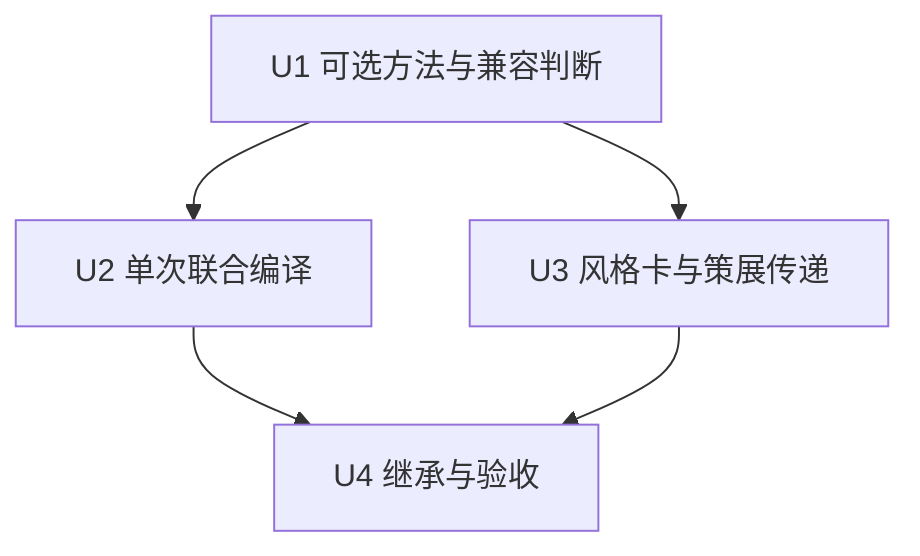

# feat: 接入情绪与叙事驱动的联合美术配方

## Summary

扩展原计划的可选配色描述，使其携带整体／局部关系、明暗块面与媒介用色方法；在统一入口内先确定既有主导语言，再协调颜色、光线、构图和自动探索。沿用四个实施单元、聊天入口和现有词库，补齐方法消费、继承及视觉验收，不增加界面、模型调用或数据迁移。

这是一份实施计划，不是已上线的功能说明；本轮不修改运行代码、不运行应用测试、不产生付费分析或图片生成。

---

## Problem Frame

用户希望颜色的聚散、明暗与艺术参照、媒介共同服务故事。当前标签和色板未表达完整的空间与尺度关系；独立添加颜色与自动构图／媒介规则可能产生矛盾或趋同。（see origin: `docs/brainstorms/2026-10-11-emotion-color-harmony-requirements.md`，2026-10-12 更新）

---

## Requirements

沿用 origin 的 R-ID，不另起编号：

- R1–R4：分别表达具体色板与关系，支持单色相、邻近色、互补、分裂互补和三角色；面积、饱和度、明暗与空间位置共同决定表达，不补造内容或精确数值。
- R5–R9：当前证据驱动，用户指令与确认事实优先；无证据、并列或用途不相容时退回；支持聊天修正，不固定情绪与颜色，不以换色替代构图或媒介差异。
- R10–R11：后续策展提取开放的配色、明暗、尺度和媒介协调观察及可执行方法；兼容旧数据，不自动继承原图色板，不泄露名字、情节、路径或截图污染；新卡仍需 draft 筛选。
- R12：单次权威编译，选中方法到达最终指令，不要求图片模型精确实现角度或百分比。
- R13–R14：亮暗块面、重心和边缘参与构图；整体配色与局部笔触关系分开，颜色交接方式须与媒介相容。
- R15–R16：复用既有主导语言及一主一辅上限；艺术参照按有依据的方法而非固定色卡。已确认组合卡不拆换，聊天局部修正不重选整体，实际视觉验收覆盖灰度、焦点、媒介、事实与多样性。

Origin acceptance examples AE1–AE14 全部进入下方测试或视觉验收；文档检查不替代真实出图美观度验收。

---

## Scope Boundaries

- 不新增前端组件、色环编辑器、设置页、API endpoint、模型供应商或第三方依赖。
- 不改旧情绪画像、时间服装机制、主风格与辅助效果数量限制、人物身份及故事事实。
- 不批量改写现有 `art-repository/catalog.json`，不重分析 99 张参考图，不改 ready/pending 或权利状态。
- 不实现像素级色环统计、颜色科学换算、生成模型训练或固定情绪配色表。
- 不实现生成后的自动调色、灰度检测或评美模型，不扩建通用美术框架、不拆换既有 active 组合卡。灰度阅读是人工视觉验收方法，不是新增产品功能。
- 不自动合并、推送、部署或生成付费样图。业务数据只能由主仓库服务读写；worktree 不启动服务。

### Deferred to Follow-Up Work

- 真实样图对照验收：实施后提供内容与报价，获得明确费用确认再执行；在完成前保留视觉质量待验收状态。
- 历史卡片筛选、全库补分析、全文语义检索、私有对象存储迁移及其他 prompt 历史问题均不搭车处理。

---

## Context & Research

### Relevant Code and Patterns

- `server/services/renderGate.ts`：`engineerImagePrompt` 是唯一编译入口；`preservePrompt` 早返回；`cleanInstructions` 合并持续要求与本轮 intent，并优先保留最新文字。`authoredBrief` 与锁定 style 会停止自动美术添加。
- 当前 gate 先追加自动构图和图库片段，后选择配方／手动风格／语义卡。联合判断需在同次编译中暂存自动片段、确定主导语言后再消解新规则，不重复选择风格或全面改写旧自由文案。
- `server/services/styleLibrary.ts`：手动 `styleToFragments` 会消费 palette 等字段；自动 `getSemanticArtCards` 只传 `provider_fragments` 等选择元数据，不能假定新增 YAML 方法自然进入自动 prompt。新增可选方法须通过这两条路径显式传递。
- `shared/semanticArtDirection.ts` 的 `SemanticArtCard` 和 `server/services/semanticArtDirectionCatalog.ts` 返回已选主辅卡；可选方法随同一结果携带，不重新打分或以艺术家名字查一遍库。
- `docs/style-library/entries/modernist-sanyu-seurat-wu.yaml` 为已确认 active 组合，现有 provider 方法是概括色面、书法轮廓与疏密点触。`docs/style-library/entries/dreamy-colored-pencil-minimal.yaml` 明确彩铅叠色；本计划用这些现有语言作兼容参照，不修改其状态或自动补造作品出处。
- `server/services/semanticEvidenceNormalizer.ts`、`server/services/semanticArtDirectionCatalog.ts`：证据记录来源、权重、否定、引号和主体；低证据与并列跳过。新配色沿用保护思想，但不改变风格卡打分或主辅名额。
- `shared/artDirection.ts`：确认配方与候选均使用 `ArtRecipeDNA`，旧字段都是字符串数组。`normalizeRecipeDNA`、`deriveStoryArtRecipe`、`rankedValues` 和 `artCandidatesNeedConvergence` 需要注意新增非数组字段后的兼容。
- `shared/artPromptLibrary.ts` 的 `artRecipeToLibraryItems` 当前逐项复制六个字段；`server/routers/storyAgent.ts` 的 artStyle.recipe 输入也只列出这六项。可选字段必须过这两处边界，不能只增加 TypeScript 类型就宣称能保存。
- `server/services/artRepository.ts`：只返回清洗后的 ready DNA。`colorRelations` 用于词组匹配，但 `curatedDnaPromptBlock` 不输出这些标签，也不输出 `palette`；不能通过直接拼接标签绕过此边界。
- `server/archive/visionAgent.ts`：虽然在 archive 目录，当前 `scripts/analyze-art-references.ts` 与 `server/services/artAgent.ts` 仍调用它。`purpose: art-curation` 独立追加开放提取规则；普通照片路径必须保持不变。
- `scripts/analyze-art-references.ts`：有显式费用确认、批次上限、失败保留 pending 和按条目保存；只扩展结果接收，不执行真实批处理。
- `server/services/publishingCoverArtDirection.ts`：封面美术继承使用章节白名单。新增配色块不加入白名单就会在继承时丢失。
- `server/services/publishingAlbumBackgroundPrompt.ts`：画册采用 authoredBrief，继承封面后不再搜索美术方向，必须继承而不是重新推断配色。
- `server/services/creationAgent.ts`：改图已把 `input.message` 作为 intent；首次 `generateNextImage` 的 gate context 未传独立 intent，需检查聊天工具参数到入口的实际传递，不把聊天全文或长期画像当当前证据。
- `server/routers/storyAgent.ts`：生成入口已传 `explicitInstruction`，但有参考画面或封面继承时会启用 authoredBrief / preservePrompt；这些保护不能为配色功能被撤掉。
- `server/routers/publishingDraft.ts`：封面编译后保存生成计划；续页/正文底图已有继承配色及低对比要求，应继续优先于自动配色。
- 技术栈为 TypeScript、Zod、Vitest；沿用现有 normalizer、服务与离线 mock 模式，不新增框架。

### Institutional Learnings

`docs/solutions/architecture-patterns/semantic-art-direction-library-handoff-2026-09-03.md` 的有效教训：当前情绪与旧画像隔离、明确指令优先、艺术家参照内部化、无证据和并列时跳过。其历史 Git 状态、路径与测试统计不作为当前环境证据。

### Research Boundary

现有时间语境、语义风格和图库清洗链路提供可复用的直接模式。本次不新增外部接口、不做数值色彩运算，外部框架研究不会改变接入方式，故以当前代码与确认需求为依据；真实视觉效果留到实施后的样图验收。

---

## Key Technical Decisions

- 沿用一个共享的可选 `colorDesign` 描述，不再另建“联合配方”框架。它服务于确认配方、策展 DNA、风格卡和统一编译；包含整体关系、可选局部关系及其尺度、面积与强度、明暗块面组织、边缘特征和媒介颜色交接方式。每一项独立可缺失，缺失不是默认蓝橙、固定比例或默认柔焦。具体枚举由实现按已知美术行为校准，开放观察仍保留在现有标签／策展文字。
- 关系采用描述性美术色环约定。单色/相邻/对向/对向两侧/三角均分是概念坐标；首版不储存或计算具体色相角，不把 HSL 的 180° 等同于颜料色环或感知距离。
- 可执行方法使用有界、颜色无关的值和受控文案，例如“背景主导、局部点睛”“低饱和、有限明暗差”。具体色名仍在原有 palette 中。源图观察标签继续开放保存，绝不直接作为 provider 指令。
- 配色属于美术方向的一个维度，不是第二张主卡或新增辅助效果。新服务只选择和序列化描述，不能调用模型、数据库或 provider；统一入口负责事实与指令优先级。
- 明确指令优先；自动候选使用当前情绪与当前叙事/视觉表达的组合证据，不用单个情绪词直接映射唯一关系。显式“互补”“同色系”等可直接选择；“孤独”单独不强选，而“孤独但有期待”可成为对照候选的证据，不预置蓝与橙。
- 五种显式关系是可执行指令解释，不作为新自动风格卡激活。后续新增或大改卡片依旧默认 draft；未知、未审核的自由词不能绕过现有筛选。
- 对颜色、关系、面积、饱和度、明暗、位置逐维记录已指定/开放/不确定。不确定时保守停止自动补充该维度。已有色板不是整个风格锁，但自动关系若需增添新颜色才成立，就不应用。
- `preservePrompt`、`authoredBrief`、锁定 style 时不新增块；明确修正仍走已有用户指令路径。视觉参考的身份/服装颜色不可更改；仅允许用户授权改变的背景或未锁定部分补充配色。
- final prompt 中仅产生一个 `【配色关系】` 块；配方序列化、策展方法、风格片段中的颜色约束先汇总消解，再输出。旧自由文本美术不能可靠分解时原文保留并停止冲突维度的自动方案，不为此次功能全面重写历史卡片。
- `【配色关系】` 扩展承载联合方法，章节名保持稳定以兼容继承；仅含可全局复用的主次、尺度和制作方法。当前镜头的亮暗块面落点、重心和人物／物件颜色留在本镜头段。整体柔和可与局部互补点触共存，不把两者当重复或矛盾；同一尺度的冲突才需消解。
- 主导语言来自已有确认配方 > 手动风格 > 既有语义主卡路径，不另选第二张卡。显式媒介／构图约束优先；已匹配策展的新方法只补充相容的开放维度，不因标签数量多压过主卡。无主导语言时只应用有证据的独立关系，不伪造艺术家或媒介。
- 先用有界结构判断透明叠染、干性叠色、不透明色面、点触并置等行为与已知媒介是否相容；旧片段仅对可明确识别的约束做保守保护，未知不猜测。艺术家名字、作品／时期与关联依据沿用内部参照槽位，输出只含审核过的可观察方法，不按姓名绑定色板。
- 风格卡可选方法必须由 `StyleEntrySchema` 接收，经手动片段与语义卡路径到统一入口，再受控输出。实际条目的新增／大改另走 draft 筛选；实施测试使用临时卡或内存夹具，不能借 schema 接通之机改变现有 active 卡的配方。
- 编译内部同时持有最终文本与本次选用的结构化描述，已有字符串返回入口与 provider adapter 契约保持兼容。需要保存配方的现有调用点接收同一次编译的描述，不再次运行选择器，也不把候选生成等同于用户确认。正式封面可继续以已保存的最终提示词为继承权威。

### Compatibility / Ownership Matrix

| 输入状态 | 配色处理 |
|---|---|
| 原文透传 / 完整作者方案 / 锁定 style | 不追加、不重新选择 |
| 用户明确指定关系或强度 | 解释本轮要求，仅覆盖获准的维度 |
| 已确认配方或正式封面 | 保留其配色描述；不依情绪重新选色 |
| 参考图锁定身份或构图 | 保持可见颜色，自动方法不能给锁定对象染色 |
| 无锁定、有明确当前证据 | 选择一个相容方案，不固定色板 |
| 无证据、同分、数据无效 | 不追加配色；旧出图链路继续可用 |

---

## Open Questions

### Resolved During Planning

- 色环模型：采用概念性关系，不进行数值运算，因此不需要新色彩库或强制角度字段。
- 配色与标签：开放索引用既有 `artTags.colorRelations`，可执行方法使用可选结构并受控序列化；不把标签整套注入。
- 数据迁移：采用缺省兼容的可选字段；不修改 schemaVersion、不回填真实图库、不改数据库结构。
- 配方继承：可选描述必须随候选、配方版本和正式封面保存。喜欢多个方向时只保留共同且相容的描述；冲突不混拼，继续用已有收敛流程。
- 视觉验收：先离线验证指令与边界，再在费用确认后按固定内容对照，不以自动测试断言“最好看”。
- 联合表达：同一可选结构描述整体／局部尺度与泛化块面方法；具体位置不全局继承，不新增分析调用或像素计算。
- 艺术参照消费：随既有已选卡传递可选方法；现有组合卡原样保留。内部参考使用已有槽位，缺乏证据不补作者、时期或作品。

### Deferred to Implementation

- 精确证据词和泛化枚举数量：在五类关系、受控输出与无证据退回边界内用回归样例校准；不承诺完整自然语言理解。
- 指令和模板的长度预算：以现有短/长 prompt 上限回归决定最终文案长度，不削减最新用户要求或末尾硬规则。
- 内部编译描述传递的具体 helper 形式：兼容已有字符串入口，复用一次编译，不新增外部响应要求或持久化系统。
- 自由文本约束的可识别范围与受控兼容清单：以彩铅叠色、透明叠染、不透明色面和局部点触等回归夹具确定；未知或无法解释的已有语言保持原样并跳过冲突补充，不承诺完整美术语义理解。

---

## Implementation Units

依赖顺序：U1 是共享基础，U2 与 U3 基于 U1，U4 验证两条链路的汇合。

### U1. 可选配色描述与证据选择

**Goal:** 统一表达整体／局部配色、明暗块面和用色方法，提供无副作用的解释、候选选择与兼容判断；保留已确认配方。

**Requirements:** R1–R5、R7–R9、R12–R16；AE1–AE3、AE5、AE9–AE12、AE14。

**Dependencies:** 无。

**Files:**

- Create: `shared/colorHarmony.ts`、`server/services/colorHarmonyDirection.ts`。
- Modify: `shared/artDirection.ts`、`shared/artPromptLibrary.ts`、`shared/semanticArtDirection.ts`（可选方法的共享透传契约）、`server/services/semanticEvidenceNormalizer.ts`；只扩充配色需要的证据，既有概念得分不变。
- Test: `shared/colorHarmony.test.ts`、`server/services/colorHarmonyDirection.test.ts`、`shared/artDirection.test.ts`、`shared/artPromptLibrary.test.ts`、`shared/semanticArtDirection.test.ts`、`server/services/artDirectionTypes.test.ts`、`server/services/semanticEvidenceNormalizer.test.ts`。

**Approach:**

- 规范化可选关系、面积、饱和度、明暗和泛化落点，限制字段和值，不接收原图人物、物体、艺术家或具体色名作为自动方法。混合关系可在观察中共存，但单次出图只选择一套相容方法。
- 区分整体色域与局部笔触关系及尺度，允许低对比整体加细小互补点触；明暗表达亮暗块面的主次、连断与边缘，不只存一个整体亮度。颜色交接方式保留对已知媒介的兼容要求，未知媒介不自动指派方法。
- 纯兼容判断接收同次已选的语言及显式约束，不读取艺术家名来定色；可解释冲突只舍弃低优先级的新维度，无法解释的旧自由文案不改写。聊天要求如“颜色保留、亮面移到侧边”拆成保护和获准修正，不全面重选配方。
- 延续来源、否定和引号保护；按语句和当前指令先后识别修改，不能仅用第一处关键词定案。“不要单色，改互补”选择互补；条件句或他人对白不升级为指令。
- 明确关系 > 当前情绪与镜头的组合证据；自动打分按去重证据计分，最高并列或不足阈值时返回未应用原因。不得为打破并列随机选或依据年龄、历史画像选。
- 所有情绪候选不附带固定色板。同色系和互补都允许通过其他叙事证据成为同一情绪的候选。
- 新字段在配方规范化、候选往返与版本保存中保留；缺字段保持旧行为。限制数组字段统计到原有六个数组字段，避免把结构对象当可迭代字符串。
- 共享语义卡的可选方法契约在 U1 建立，使 U2 可先用内存卡验证消费；U3 负责真实 YAML 装载与传递，U4 验证汇合。U2、U3 不互相等待未声明的类型改动。
- 美术库配方保存沿用现有 `art_style_recipe` 文本维度，追加配色描述的受控方法摘要而非结构 JSON，不覆盖已有文字；回读只解析可识别摘要为新描述，旧任意 prose 保留且不猜测。原有六维条目不变，结构化快照仍随故事配方保存，不新增库字段或维度。
- 多个 liked 配方仅合并一致的配色维度；不一致维度留空并让已有收敛判断识别实质冲突，不平均互补与单色或把数字面积投票拼接。

**Patterns to follow:** 现有语义证据 normalizer、配方缺省处理与空候选退回；不引入插件、远程推理或通用规则框架。

**Test scenarios:**

- Covers AE1 / AE3. “孤独但有期待”产生有依据的对照候选但无蓝橙色名；“难过但想要红色”不转蓝色；单个情绪词不能决定唯一配色。
- Covers AE2. 显式五类关系均可解释；“互补但柔和”得到有限对比，而非五五分的高饱和默认。
- Covers AE5 / AE9. 空输入、年龄、历史情绪、引号内对白、否定证据、并列候选均不强选；重放相同输入结果一致。
- “不要互补”“不用三角色，改同色系”、重复同词及先否定后肯定的文本均按本轮有效指令处理。
- 无字段/null/未知关系/超长数组/错误面积值局部退回；一个坏维度不删除其余有效信息。
- 单个 liked 候选的描述往返不丢失；多个 liked 中冲突关系不合并，共同的低饱和属性可保留；原有字段排名与否决统计不变。
- 配方保存为既有美术库条目再回读，新描述可恢复；旧六维条目仍可用，原始结构文本不进入生成指令。
- Covers AE10 / AE11. 同样的颜色与总体明暗但不同块面组织产生不同受控表达；整体邻近／柔和与细粒互补可共存，不能升格为全幅对撞。
- Covers AE12. 已知彩铅叠色与不透明厚涂冲突时舍弃低优先级方法；未知媒介不猜测，未知一个维度不抹掉其余可用信息。
- Covers AE14. 局部修正保留原色板、媒介与全局关系；冲突聚合不平均不同尺度或把镜头位置当全局属性。

**Verification:** 五种关系、混合观察、缺失退回与确认配方往返都有行为证据；旧语义风格测试不被新词改变选择结果。

### U2. 统一入口接入与聊天指令保护

**Goal:** 配色实际到达图片模型，同时不改用户事实或重复套规则。

**Requirements:** R4–R9、R11–R16；AE2–AE6、AE8–AE14。

**Dependencies:** U1。

**Files:**

- Modify: `server/services/renderGate.ts`、`server/services/creationAgent.ts`、`server/routers/storyAgent.ts`（配方输入的可选字段接收）。
- Inspect / modify only if needed to forward current explicit inputs or read recipe items: `server/routers/creationAgent.ts`、`server/routers/publishingDraft.ts`、`server/services/artPromptLibrary.ts`。
- Test: `server/services/renderGate.test.ts`、`server/services/renderGate.longPrompt.test.ts`、`server/services/creationAgent.test.ts`、`server/routers.storyAgent.test.ts`、`server/routers.publishingDraft.test.ts`、`server/services/visualAssetCreation.test.ts`；库回读若需修改，同步扩展 `server/services/artPromptLibrary.test.ts`。

**Approach:**

- 在 gate 内汇总用户要求、配方描述、手动风格/语义片段、时间色调、已匹配策展方法以及参考策略；统一决策后仅输出一次配色块。
- 在同次编译中先取得主导配方或风格选择，再协调新增联合方法及尚未输出的自动构图／媒介探索。保持现有选择优先级、主辅数量和图库匹配算法；局部亮暗组织服从当前构图，不利用亮暗设计偷偷增添光源、道具或第二个主体。
- 新结构化方法不在 `styleToFragments`、`artRecipePrompt`、图库段落和 gate 四处分别序列化；收集后统一输出。旧六维文本与既有卡片语言保留，不能可靠解释时停止新冲突维度；不以联合化为理由全量改写旧段落。
- `【配色关系】` 只承载可全局继承的方法；当前镜头的颜色落点放在已有本镜头内容段，与其人物/物件事实绑定，不构成第二个可继承配色块。
- 同次编译的配色描述随现有候选/配方保存调用传递，正式采用后才作为已确认方向。入口输入规范接收可选字段；自动生成或解析失败时不修改已确认配方。已有 `engineerImagePrompt` 的字符串结果与 `renderViaGate` 的泛型生成结果均保持兼容。
- 尽量不改各片段原文，只在必要接入处将新增结构与自由文本分离。用户明确颜色与故事明确事实先锁定；低优先级文案若与其冲突就不输出冲突维度。
- preservePrompt 仍早返回，完整美术与 style 锁仍跳过所有自动配色。原图身份/服装保护优先；普通参考图存在但其颜色权限不明确时保守跳过自动改色。
- 部分明确要求如“暖色再少一点”可修改已有方案的面积，不重选其他颜色或关系；若没有可辨认的暖色基线，则保留用户原话，不编造色板。
- 首次聊天出图与后续改图均确保当前美术要求进入独立指令字段；不传聊天全文、长期画像或参考图情绪为用户当前心情。不改变聊天回复 UI 或新增控制项。
- 现有实际用途 union 不包含 product / factual / standard-view，不能只增加不可达枚举。标准资产视图通过 `server/services/visualAssetCreation.ts` 的 authored/locked 路径保护；实际事实性任务不明确时停止自动配色，后续新用途沿用同一限制。
- 控制新块长度和位置，保护已有最新用户要求、内容事实与末尾硬规则。仅在无完整锁且开放维度中加入多候选配色探索，不能替换已有构图/媒介探索。

**Execution note:** 先补锁定、长度与明确颜色覆盖的特征化用例，再改变统一入口。

**Patterns to follow:** `cleanInstructions` 的最新要求优先、现有 authoredBrief 测试、实际 provider callback 截获编译结果。

**Test scenarios:**

- Covers AE2 / AE3. 本轮“互补但柔和”到达 provider；明确红色保留，自动不补蓝色；风格或年代色调不得反向否定它。
- Covers AE4 / AE6. 已确认墨绿米白配方、红色衣服及故事板可见事实保持；“只改背景”不影响衣服；preservePrompt 结果原文一致。
- Covers AE5 / AE9. 未命中或配置/字段无效时出图继续，新增块不存在；并列不产生两套规则；标准视图不被染色。
- Covers AE8. 多候选开放配色可探索，锁定色板时不得换色；原有构图分叉块仍存在。
- 新块计数最多一次；手动风格、配方和自动方案同时存在时按优先级输出；作者完整美术不增加新块。
- 短/长 prompt 接近上限时，最新改色指令和静态风格化/无字硬规则仍有效，新自动块优先被舍弃而非截断用户约束。
- 聊天首次生成及 revise 用离线 provider mock 捕获最终 prompt，证明是用户本轮要求而非工具原文或旧情绪；生成失败不改现有资产。
- 自动选择到候选保存、用户确认再到下一次编译的描述一致，选择只运行一次；新字段过 route 输入不会被剥离；未确认候选不能改写正式方向。
- Covers AE10–AE12. provider 捕获可区分块面连断、整体与局部尺度；确认彩铅方案没有新增厚涂或全幅点彩。自动构图与明确侧置重心一致，不补无关物件。
- Covers AE13. 现有 active 组合的选择和 provider 可观察片段保持，不按三位艺术家名生成三套颜色；内部名字、作品出处不输出。
- Covers AE14. 本轮“别这么居中，亮面移到侧边，颜色保留”只影响获准构图／局部明暗；锁定布局不静默解除，现有聊天回复说明限制，不新增 UI。

**Verification:** 实际静态图入口到 provider 的最终字符串满足保护规则，而不只是纯函数结果；不增加付费调用次数。

### U3. 风格卡与参考图方法传递及隔离

**Goal:** 后续参考图能观察联合方法，审核过的风格卡与 ready DNA 可将可选方法传到统一编译，不复制原图颜色或只保存标签。

**Requirements:** R1–R4、R10–R15；AE7、AE9–AE13。

**Dependencies:** U1；接入 U2 后验证最终输出。

**Files:**

- Modify: `server/archive/visionAgent.ts`、`scripts/analyze-art-references.ts`、`server/services/artRepository.ts`。
- Modify: `server/services/styleLibrary.ts`（基于 U1 的共享契约透传可选方法；既有选择规则不变）。
- Test: `server/archive/visionAgent.test.ts`、`scripts/analyze-art-references.test.ts`、`server/services/artRepository.test.ts`、`server/services/artRepository.catalog.test.ts`。
- Test: `server/services/styleLibrary.test.ts`、`server/services/styleLibraryWordBank.test.ts`、`shared/semanticArtDirection.test.ts`、`server/services/semanticArtDirectionCatalog.test.ts`。
- Docs: `docs/style-library/_TEMPLATE.yaml`、`docs/style-library/CODEX_PROMPTS.md`、`docs/style-library/MANUAL.md`（增加配色方法说明，不激活新卡或新增未消费字段）。

**Approach:**

- 仅 art-curation 分支提示先自由观察，再识别色相聚散、主辅面积、强度、明暗和泛化位置。色彩关系索引仍写 `artTags.colorRelations`，可执行描述写可选 colorDesign，未知留空，不靠截图文字判断。
- 同时观察块面连断、边缘软硬、整体与局部关系及媒介颜色交接；开放观察用既有 composition、markMaking、colorRelations 或 freeTags，不为每个观察增设强制分类。艺术家／作品时期关联有证据才写内部参照与依据，不依据署名或截图配文鉴定。
- 风格 YAML 的可选方法经 schema 接收、规范化后随同一手动条目或已选语义卡传递至 gate；无字段的旧卡、草稿或未选卡不增加方法。手动原有色彩片段保持原路，新结构不另外输出一次。
- 模板和维护文档增加待筛选的联合方法示例，说明内部参照、开放观察与可执行方法的区别；不修改现有 active 条目、不新增自动激活卡，也不虚构艺术家固定调色盘。
- 普通照片的 schema 与提示词不增加该字段；策展分支的 normalize 明确处理可选结果，脚本传递并清洗后保存。
- 开放标签不强制唯一分类，新增结构仅接收允许的泛化值。原图色名留在旧 palette，不渗入新的关系文案；不接收来源具体人物、物件、地点或无界自由指令。
- gate 获取同一批已匹配、清洗后的 DNA 来选择色彩方法；重用既有读取/匹配，避免为新服务重复载入图库，也不由 `curatedDnaPromptBlock` 另加第二个配色块。匹配算法与数量上限保持不变。
- 旧 ready 没有新字段仍可使用原方法，旧标签不自动升级为可执行方法。pending/rejected 及未匹配记录不能参与。
- 保留显式费用确认、失败保持 pending、原图 hash/rights 不变；测试只用内存或临时目录，不触碰实际业务目录。

**Patterns to follow:** 既有 purpose 分支、`sanitizeCuratedArtDna` 再清洗、脚本 dry-run 与 mocks。

**Test scenarios:**

- Covers AE7. 邻近背景加互补点睛可记录混合关系；不确定面积只记录概述、不制造百分比；以不同源图色板产生相同方法而不携带色名。
- 旧缺字段、结构 null、未知值及某个维度无效时，其他 ready DNA 保持；普通照片 prompt / result 无新增配色结构。
- 带艺术家/人物/具体物件/水印/路径 sentinel 的新结构不进入运行时；自由标签能检索但不会被整套输出。
- 同一 ready 方法由匹配进入 gate，最终只出现一个配色块；无匹配或 pending 方法不出现；具体 palette 不自动继承。
- 脚本未确认时无模型调用、无读图、无写入；确认的 mock 结果仅更新所选条目，新字段往返保留，失败仍 pending。
- Covers AE11 / AE12. 近看细小冷暖并置可与整体柔和共存；媒介方法不确定留空，其他观察保留，普通照片路径不变。
- Covers AE13. 临时 active 卡的可选方法经手动与语义路径各到 provider 一次；draft／未选卡不出现。真实组合卡的状态和正文未改，新增内部作品参照不泄漏。

**Verification:** 通过模拟视觉结果到脚本保存、清洗、检索再到最终 prompt 的链路证明字段既可保留又可消费；真实目录内容、原图及状态不改。

### U4. 封面继承、功能记录与验收交接

**Goal:** 已采用方向不在续页丢失，形成可执行证据和真实样图验收清单。

**Requirements:** R6、R8、R10–R16 与 origin Success Criteria；AE4、AE6–AE8、AE10–AE14。

**Dependencies:** U1、U2、U3。

**Files:**

- Modify: `server/services/publishingCoverArtDirection.ts`。
- Inspect / modify only to retain the new block: `server/services/publishingAlbumBackgroundPrompt.ts`。
- Test: `server/services/publishingCoverArtDirection.test.ts`、`server/services/publishingAlbumBackgroundPrompt.test.ts`；跨链路回归沿用 `server/services/renderGate.test.ts` 与 `server/services/artRepository.test.ts`。
- Docs: `docs/features/feature-ledger.json`、`docs/qa/2026-10-11-color-harmony.md`。

**Approach:**

- 增加配色块到封面可复用章节白名单，但该块只包含全局配色关系和主辅方法。当前镜头的局部颜色落点属于本镜头内容，不写入可全局继承的章节，避免续页照搬封面的光点位置或增加物件。
- 采用封面后续页继承原文关系与色板，不重新按本页情绪选择；页内位置仅在既有颜色/事实范围内安排。正文底图浅色和低对比规则不受影响。
- 在所属账本卡追加能力、权威文件、测试证据与待验收缺口，不因有文档而宣布 working。沿用三张能力卡，不另造重复功能卡。
- QA 清单提供三组固定内容对照：安静相处（单色/邻近）、孤独但有期待（柔和互补/分裂互补）、有玩心的重逢（邻近/三角色）；同组媒介与构图保持可比。记录颜色主次、饱和度、叙事适配及是否改写事实，由用户评价，不设置“情绪唯一正确配色”。
- QA 分开验证两种问题：固定内容／媒介／构图的配色对照用于检验关系；联合配方样例用于观察颜色、块面与笔触的整体协调，不能把后者归因于单一颜色变化。另用多个不同故事检查重心、景别和媒介重复，不要求同一故事内部破坏风格一致性。
- 人工视觉检查包含灰度缩略阅读的主体层级、色彩焦点与面积、整体／局部尺度、边缘与媒介一致性、参考事实保留和叙事适配；给用户展示原图并记录接受／修改意见，不用提示词长度、关键词数量或自动打分代替美观验收。
- 离线回归、类型检查和功能账本验证后，只回主仓库 3000 检查已有聊天流程；不得在 worktree 启动服务或写 `.webdev`。真实生成须另行确认报价，没有真实样图则明确标注质量未验收。

**Patterns to follow:** 现有封面章节白名单、画册 authoredBrief 继承与功能生命账本状态定义。

**Test scenarios:**

- Covers AE4. 新封面关系可提取并原文继承；旧封面无新块行为不变；未授权画面的提示词不作为当前故事封面继承。
- Covers AE6 / AE8. 续页重新设计构图但不换已确认色板；红衣身份参考保留；多候选不只换色。
- 新章节不吞并其后非美术章节、不带封面主体布局或位置；原有内容与无字约束仍存在。
- 画册编译不二次推断配色；正文底图继续低对比；没有可继承美术方向时维持已有错误提示。
- Covers AE10 / AE11 / AE14. 全局用色与尺度继承，但封面亮点、人物位置和块面布局不复制到新页；页内修正不更换已确认色板／媒介。视觉 QA 标注未执行付费出图，离线断言不冒充像素或美观证据。

**Verification:** 关系从正式封面到续页可追踪且未复制局部内容；账本验证有效；QA 清晰区分离线结果与待确认的真实视觉验收。

---

## System-Wide Impact

- 出图：聊天、故事图、封面和画册共享同一编译入口；provider adapter 不增加规则。新增选择不增加付费推理或读库次数。
- 持久化：可选字段随已有配方/策展 JSON 保存，不引入 DB migration 或自动回填；旧数据正常读取。候选聚合与版本往返必须保留确认结果。
- 信任边界：参考图片和视觉模型结果是数据，不是指令；只将清洗后的 ready 方法转成受控文本，私有图不因此新增发送路径。
- 错误传播：新增字段无效只跳过相关配色维度；不把配色解析失败变为出图失败。沿用现有图库错误行为，不在此全面修改其他失败机制。
- 运行：主仓库已有其他未提交修改，实施前重新核对 Git 与功能账本；只改相关文件，禁止覆盖移动端、登录、个人记忆等工作。

---

## Risks & Dependencies

| 风险 | 处理 |
|---|---|
| 情绪词导致固定颜色或漏检近义表达 | 不绑定色名；组合证据、并列退回；明示词汇识别不是完整语义理解 |
| 老配方/自由文本与新结构矛盾 | 老方案优先；按维度保护；不可靠时不追加，而不是猜测 |
| 新非数组字段破坏候选统计 | U1 明确分离数组统计字段，覆盖规范化、聚合和收敛 |
| 自动规则稀释作者要求或占满 prompt | 全锁不新增；对短/长上限分别回归，自动块最先舍弃 |
| 来源色板、人物或指令污染泄漏 | 有界颜色无关结构、二次清洗、provider sentinel 集成断言 |
| 封面位置被续页照搬 | 全局关系与当前镜头位置分离；只继承全局章节 |
| 新 YAML 字段被剥离或只保存不消费 | U3 覆盖 schema、手动／语义传递与 provider 捕获；真实 active 卡保持不变 |
| 局部点触被误解成全幅撞色，独立媒介与构图规则冲突 | 显式尺度与主导语言约束，同次编译暂存自动片段后协调；未知旧文本不猜测重写 |
| 提示词正确但图片不好看 | 付费确认后做固定内容视觉对照；不提前宣称美观验收 |

---

## Documentation / Operational Notes

只在实施完成时更新所属功能历史和证据；保留真实视觉验收、关键词匹配和历史 draft 卡片的已知缺口。回退代码时，带可选字段的数据不需删除；旧版本忽略未消费字段，不重写业务图库。

---

## Sources & References

- Origin: `docs/brainstorms/2026-10-11-emotion-color-harmony-requirements.md`。
- Constraints: `AGENTS.md`、`docs/features/README.md`、`docs/features/feature-ledger.json`。
- Learning: `docs/solutions/architecture-patterns/semantic-art-direction-library-handoff-2026-09-03.md`。
- Authority: `server/services/renderGate.ts`、`shared/artDirection.ts`、`server/services/artRepository.ts`、`server/archive/visionAgent.ts`、`server/services/publishingCoverArtDirection.ts`。
