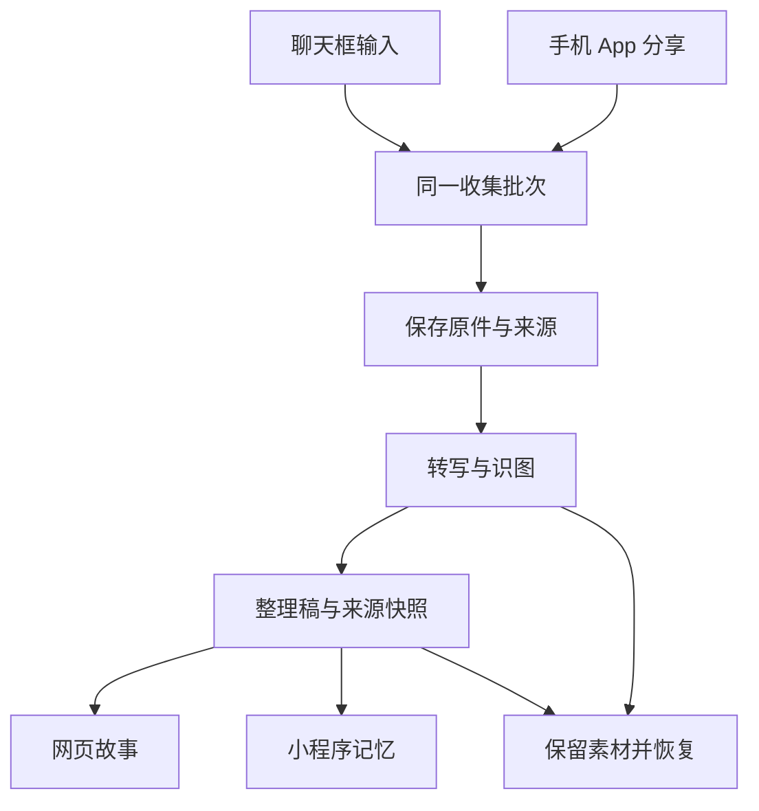

# 手机聊天与系统分享收集素材

## 目标与当前状态

用户确认同时需要两种入口：在现有聊天框输入文字、发送图片与录音，以及从手机其他 App 的分享菜单发送素材。小程序整理为记忆，网页整理为故事；保留原始材料、来源与整理历史。

本文件是实施方案，不代表功能已实现、真机验收或发布。当前只读核对网页 `main` 0695d192 与小程序 `main` 756dde9；网页存在其他会话大量未提交修改，不能覆盖、清理或一并提交。

**目标仓库：** `drinking-time-local`（本文所在仓库）与 `shiguang-jiayi-hackathon`（独立小程序）。下文 Web 路径相对前者，Mini 路径相对后者；网页仓内的 `miniprogram/` 不是此次独立小程序的修改对象。

---

## 需求

- R1：聊天框支持文字、图片、现场录音和已有录音文件，允许同一批混合发送。延续现有聊天入口，不要求先创建空故事、指定镜头或填写素材表单。
- R2：提供从其他 App 分享内容的入口；仅对平台真实支持的路径展示可用状态。源 App 未提供的数据不能假装已收到，链接不能冒充已读全文。
- R3：提交后自动整理并保存为新的记忆或故事，结果在聊天中可打开、编辑、查看来源。新的接收批次默认独立；明确补充现有内容时新增版本，不静默覆盖。
- R4：原文字、原图片、原音频与转写、视觉描述、整理稿分别保留。AI 推断不能冒充用户陈述；没有文字说明的照片不编造人物身份、时间、关系和经历。
- R5：成功提示以权威保存回执为准；跨浏览器可读取，同一批次重试不能重复创建素材、记忆、故事或重复付费。部分上传、断网、模型失败均可恢复。
- R6：素材按当前登录身份隔离；网页账号与小程序账号不因昵称相似而自动合并。跨端归属只使用已存在且验证过的登录映射/领取能力。
- R7：普通聊天、现有故事编辑、历史版本、图片/视频付费确认和小程序审核边界继续保留。新增收集流程不自动生成图片、声音克隆或视频。

### 与旧需求的关系

`docs/brainstorms/2026-10-11-memory-driven-work-production-requirements.md` 要求普通聊天收录为记忆、明确要求后生成版本。用户本次明确要求“发送素材后自动整理成记忆/故事”，该授权用于本次收集入口，不把所有既有续聊改成自动覆盖正文。文字/素材来源、旧版本和采用保护沿用旧要求。

---

## 已核对的能力与限制

| 表面 | 可复用能力 | 当前缺口 |
| --- | --- | --- |
| Web 手机聊天 | `MobileNewStoryCompanion`、`MobileChatView`、`useMobileConversation`；整轮请求身份、恢复与持久对话 | 现有轮次以文字为主，附件未成为统一输入 |
| Web 导入 | `MobileCompanionActions` 导入文本、图片、视频；`creationAgent.importStoryMaterial` | 媒体需要已有故事，图片只存素材，未接识图；录音文件不在导入支持范围 |
| Web 语音 | `MobileVoiceInput`、`useVoiceInput`、`voice.transcribe`、`voiceTranscription` | 现场录音转成输入框文字；此路径未保留原录音为可恢复来源 |
| Web 音频资产 | `storyAudioImport` 的分阶段写入、校验与幂等操作 | 需要接到收集来源，不能把任意输入 URL 交给旧远程下载入口 |
| Mini 记忆 | `pages/interview/interview`、`memoryOrganizerService`、`organizeMemory` | 图片导入/说明和文字整理仍分开；缺普通录音文件转写与混合来源整理 |
| Mini 现有录音 | `voiceRecorder`、`storyAudio` | 为 5–15 秒声音复刻样本设计，不得冒用为长录音转写或复用其同意记录 |
| 外部 App 分享 | Web Share Target、iOS 快捷指令有对应平台机制 | 现有 Web 尚无接收实现；不能用 `navigator.share()` 出站能力冒充接收能力 |

网页已有功能卡：`mobile-cross-device-chat-document`、`mobile-memory-followup`、`writing-memory-warehouse`。延续身份隔离、原文与助手来源区别、失败恢复、不覆盖旧稿、原素材共享引用规则。不能把代码存在当作手机实测完成。

平台依据：已查 MDN 的 Web Share Target 与 Apple 的快捷指令输入说明；微信官方文档本次网络读取失败，不能据此声称其所有能力已确认。独立小程序现有 `wx.chooseMedia` / `wx.chooseMessageFile` 调用可作为内部选择素材的代码依据。

---

## 接收方式

| 方式 | 用户操作 | 实施条件 |
| --- | --- | --- |
| 聊天内发送 | 直接输入，使用原附件入口选图/录音，或现场录音后发送 | Web 与 Mini 都做；取消选择不发出，不因页面打开使用麦克风 |
| Android 系统分享 | 从源 App 分享到已安装的拾光网页应用 | 仅支持 Web Share Target 的浏览器/安装方式；需真机确认安装后实际出现 |
| iPhone 系统分享 | 建议一次添加“发送到拾光”快捷指令，之后在源 App 分享菜单调用 | **待用户确认手机类型及是否接受快捷指令**；不同于安装网页到桌面 |
| iPhone 原生接收扩展 | 原生 App 的 Share Extension | 若用户不接受快捷指令，需要单独确定原生 App 范围，不暗中新增另一套 App 工程 |
| 微信内素材 | 小程序内从相册、拍照或微信聊天文件选择器选取 | 普通语音气泡与录音文件不是同一种输入；缺少官方入口时提供真实可用的文件/录音路径 |

普通聊天入口和共同保存逻辑可独立推进；iPhone 适配不得把“未回复”视为接受快捷指令。外部分享只处理源 App 实际交出的内容，不能读取其他 App 私有历史。

---

## 数据与保存决策

1. **一个收集批次贯穿输入、上传、整理与结果。** 每次用户发送生成稳定请求身份；网络重试复用身份，新发送才创建新身份。请求内容指纹变化时拒绝复用旧身份。
2. **原件先于生成落地。** 附件持久保存并验证归属后再转写/识图；解析结果附带来源引用和 AI 标记。原材料读取通过鉴权，不创建无权限限制的公开录音 URL。
3. **可恢复阶段而非伪事务。** 接收、上传、解析、整理、结果保存分别有可恢复状态。数据库写入与文件写入不假装原子；沿用音频 staged-import 的模式处理孤立文件与失败记录。
4. **结果只创建一次。** 记忆/故事创建与批次结果指针必须具有原子或可恢复的唯一关联；不能先创建故事再“尽力写状态”。未知供应商结果先查询原请求，不能自动重发付费调用。
5. **来源和当前版本分开。** 正文、视觉描述、转写与素材 ID 都是不同来源。新输入不得把助手推断晋升为事实；修改整理稿建立新版本，并保留其输入快照。
6. **两端一套协议语义，保留现有存储权威。** Web 使用已认证账号与正式数据库；Mini 使用微信云身份及记忆仓储。共享批次、来源和状态规则，不建立第二套故事库，也不复制整套服务端进小程序。
7. **外部入口先绑定身份。** 安装/绑定后才可上传。快捷指令若采用令牌，只允许创建本人的收集批次，不能读历史、删故事或指定他人 userId；可撤销、可过期，不放查询串和日志。Web Share Target 登录失效时先安全暂存，明确归属后再提交。
8. **不缓存旧编辑器。** 若 Web Share Target 使用 service worker，仅处理接收路径与暂存；不缓存应用 HTML、JS 或业务 API，避免重现“本地打开旧版本”。退出/换号后不自动提交前一账号的待发送材料。

此图描述共同语义；Web 与 Mini 输出由入口和已认证身份决定，不把同一批次无条件复制到两个账号。

---

## 实施单元

### U1：收集批次与原素材持久化

**对应：** R4–R6。**依赖：** 无。

**Web 文件：** 新增 `shared/materialCapture.ts`、`server/repositories/materialCaptures.ts`、`server/services/materialCapture.ts`；按现有仓储模式接入 `drizzle/schema.ts`、新的迁移和 `server/repositories/runtime.ts`。实施时确定迁移序号，不抢占其他会话未提交的编号。

**测试：** `shared/materialCapture.test.ts`、`server/services/materialCapture.test.ts`、`server/integration/materialCapture.mysql.test.ts`。

**做法：** 先建立上传/解析/结果提交状态与唯一请求身份；复用受管音频与图片存储能力。文件数、字节、解码尺寸、时长与文本长度在服务端限制；按每项返回状态，不静默截断或丢弃。不改现有故事保存入口行为。

**场景：** 混合文字/图/音频；同身份同内容并发重试只产生一个结果；同身份换内容拒绝；另一账号读取拒绝；文件写入后数据库失败可恢复；网络断开后重新打开保留来源。MySQL 与本地仓储均须有真实持久化链路测试。

**完成信号：** 不调用模型也能可靠保存、查询、恢复一个批次；不能伪称整理完成。

### U2：素材理解与整理到现有故事

**对应：** R3–R7。**依赖：** U1。

**Web 文件：** 新增 `server/services/materialCaptureProcessing.ts`、`server/routers/materialCapture.ts`；复用 `server/_core/voiceTranscription.ts`、`server/services/storyAudioImport.ts`、既有视觉分析、`server/services/textDraftHistory.ts`、`server/services/storyConversation.ts`；在 `server/routers/index.ts` 只接线。

**测试：** `server/services/materialCaptureProcessing.test.ts`、`server/routers/materialCapture.test.ts`，含一次跨仓储集成测试。

**做法：** 固定输入快照；仅使用本批次来源生成简短、可编辑的初稿，保存至现有故事和文字版本体系。自动整理限定本次收集意图。使用现有算力路由和真实计费边界；没有配置或拒绝授权时保留原件并显示未整理，不假装成功。

**场景：** 只有图片不编造时间人物；只有录音保存原音频及转写；混合来源保留关联；无可辨识语音返回可重试状态；模型超时未知不重复生成；生成完成但结果保存失败仅重试保存；补充已被他端修改的故事不得覆盖。

**完成信号：** 故事及来源刷新后可读，重复请求返回同一个故事/版本。

### U3：手机聊天内直接发送

**对应：** R1、R3、R5。**依赖：** U1、U2。

**Web 文件：** `client/src/features/mobileWorkspace/MobileChatView.tsx`、`MobileNewStoryCompanion.tsx`、`MobileCompanionActions.tsx`、`MobileVoiceInput.tsx`；新增同目录 `MobileCaptureAttachments.tsx`、`useMaterialCapture.ts`、`materialCaptureDraft.ts`。不在桌面书页增加重复操作栏。

**测试：** `MobileCaptureAttachments.test.tsx`、`useMaterialCapture.test.tsx`，更新既有 `MobileChatView.test.tsx`、`MobileNewStoryCompanion.test.tsx`。

**做法：** 复用附件入口，输入框上方显示紧凑附件预览，统一发送；结果作为聊天记录可打开。现场录音支持停止、取消并保留原文件；发送时快照与之后输入隔离。

**场景：** 文字/照片/录音单独和混发；取消文件选择/麦克风拒绝；关闭再开保持未发材料；发送中继续输入不被清空；切换账号迟到结果不回填；小屏键盘不遮挡发送；普通无附件续聊保持原行为。

**完成信号：** 手机尺寸浏览器可从空会话发送素材、打开已保存故事、刷新恢复；真机麦克风与文件选择另行标记。

### U4：小程序聊天素材整理

**对应：** R1、R3–R7。**依赖：** U1 语义定稿；独立小程序工作树。

**Mini 文件：** `miniprogram/pages/interview/interview.ts` 与 `.wxml`、`miniprogram/services/memoryImport.ts`、`memoryOrganizerService.ts`；新增 `captureAudio.ts`、`memoryCapture.ts`，云端新增专用录音转写适配与来源状态。复用现有照片审核/上传和记忆保存，避免直接修改声音复刻的 `voiceRecorder.ts` 语义。

**测试：** 新增 `tests/memory-capture.test.ts`、`tests/memory-capture-cloud.test.js`；扩展现有 `memory-import` 相关测试。

**做法：** 文字/照片/录音进入一个收集批次；经过已有内容审核、归属与 AI 同意边界保存记忆。普通录音使用独立转写授权与用途说明；服务器从本人已登记文件读取，客户端不传任意下载 URL。云配置只读核实，部署需另外执行已授权的发布流程。

**场景：** 新账号混合输入；重复保存；上传一半退出；AI 不可用保留原件；非本人文件拒绝；录音被电话打断；真机选取 m4a/mp3 后识别；原声音复刻、旧照片记忆与故事接收仍可用。

**完成信号：** 开发工具可完成相关整条流程；发布前再按项目清单做真机/新账号验收，不因单测通过直接提审。

### U5：系统分享适配

**对应：** R2、R5、R6。**依赖：** U1–U3；手机类型和 iPhone 路径待回复。

**Web 文件：** 新增 `client/public/manifest.webmanifest`、定向接收 service worker、`client/src/features/materialCapture/shareReceiver.ts`、`server/_core/materialCaptureRoutes.ts`；复用现有登录页和手机聊天，不创建第二个编辑工作区。若采用快捷指令，新增 `scripts/build-capture-shortcut` 与受限绑定令牌仓储，避免把账号永久凭据嵌入公共文件。

**测试：** `client/src/features/materialCapture/shareReceiver.test.ts`、`server/_core/materialCaptureRoutes.test.ts`、令牌作用域/撤销/过期测试。

**做法：** Android 在兼容安装环境注册接收，收到后进入原聊天；iPhone 快捷指令仅在用户接受后接入。认证失效先恢复登录再认领，外部分享参数不能指定已有故事覆盖写入。URL 仅作为来源链接，未另行安全解析时不声称读取了链接正文。

**场景：** 源 App 同时传图片和文字；语音备忘录分享；取消、重复分享、离线/登录过期；登录另一账号时不能自动认领；旧客户端 service worker 不缓存 HTML/JS；收到非支持格式明确说明；两台真实手机的安装与分享菜单分别验收。

**完成信号：** 从相册、备忘录/浏览器与录音 App 的真实分享菜单，进入拾光并打开同一份已保存结果。不能以电脑伪造 POST 代替真机完成。

### U6：两端回归与交付记录

**对应：** R1–R7。**依赖：** U3–U5。

**文件：** Web `docs/features/feature-ledger.json`、`docs/qa/2026-10-30-mobile-material-capture.md`；Mini 对应交接与发布证据。不把功能卡标为 working，直到其真实入口及验证证据齐全。

**验证：** 使用虚构文字、无私人内容的测试图片与录音；自动化验证持久化、权限、幂等及恢复；本地实际点击发送和重开；必要模型测试按当前费用授权执行。覆盖另一浏览器读取、旧稿未覆盖、删除/归档不误删来源、iOS/Android 与微信真实输入差异。

**交付：** 说明已实现、已实测、未实测与平台限制；本任务不自动部署、不提交小程序审核。工作树仅用于代码与测试，网页运行验收只在主仓唯一 3000；不制造第二份业务数据。

---

## 系统影响与待定事项

- 普通聊天与收集素材使用相同归属和保存体系，新增行为不能修改旧版保存时序或覆盖旧对话。
- 附件上传、模型调用、数据库结果提交均可能部分成功；状态恢复必须覆盖每个边界，成功回执不能提前。
- 功能 UI 可共用，两个仓库的账号和持久化实现仍有真实差异，不能将名字相同视为账号关联。
- 服务端不自动抓取用户传来的任意远程 URL，避免增加可被利用的下载入口。
- **待用户回复：** 首要验收手机类型及 iPhone 快捷指令是否接受；只影响 U5，不影响 U1–U4 的共同能力。
- **实施时核实：** 真实语音服务配置与可接受格式、图片 HEIC 解码、云函数时限、正文容量、现有图片存储访问控制、最小新增持久化字段和迁移编号。不能在方案阶段声称这些已验收。
- **方案自查：** 已补充原件优先、唯一结果关联、跨账号待发送材料保护、未知模型结果不重试付费、service worker 不缓存应用和普通聊天不自动成文的约束。手机接入选择仍为开放项。

## 参考

- [Web Share Target](https://developer.mozilla.org/en-US/docs/Web/Progressive_web_apps/Manifest/Reference/share_target)
- [Apple：从其他 App 运行快捷指令](https://support.apple.com/guide/shortcuts/run-a-shortcut-from-another-app-apd163eb9f95/ios)
- [Apple：快捷指令接收类型](https://support.apple.com/en-gb/guide/shortcuts/apd7644168e1/ios)
- 既有能力：`docs/features/feature-ledger.json`；`docs/brainstorms/2026-10-11-memory-driven-work-production-requirements.md`。
- 环境经验：`docs/solutions/2026-06-13-多worktree环境数据分裂收敛.md`；`docs/solutions/2026-06-13-故事为唯一单位-镜头按storyId.md`。
