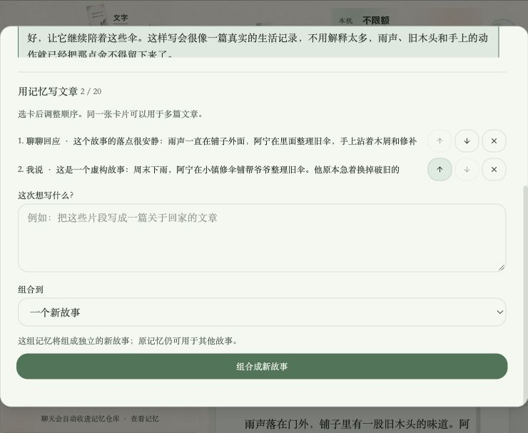

# 聊天自动记忆仓库 · 2026-10-10

## 当前行为（按用户后续明确修正）

随便聊的内容本身就是记忆，不再要求逐条点击保存。用户原话和助手回应在聊天保存完成后自动收录，打开仓库时按账号、按稳定故事ID分页补齐旧聊天。保存完整原文与双方来源，不调用模型、不推断个人事实，也不改变独立的每日来信/长期理解采集开关。较长消息拆为连续片段保留全部字符。

仓库默认「组合到 → 一个新故事」：选取与排序后，以这组记忆生成独立故事里的待采用文稿。同一段记忆可用于不同故事；也可选择在当前故事生成新稿。原文章未应用的修改、保存失败或正在回复时不会被新故事操作丢弃。保留手写卡片入口和输入框「单独记一条」。

卡片按账号保存，公共删除故事入口会先补齐记忆。归档可恢复，重复同步不会重复建卡或恢复已归档项。聊天原话发生编辑时另存快照，已生成文章的有序来源快照不变。仓库同步失败显示重试入口；普通聊天镜像失败不阻断源聊天持久化，下次打开仓库补齐。

## 自动验证

`pnpm exec vitest run server/services/chatMemoryWarehouse.test.ts server/routers.memoryWarehouse.test.ts server/services/storyConversation.personalMemory.test.ts server/services/storyConversation.mobile.test.ts server/routers.storyConversation.test.ts server/routers.storyAgent.test.ts server/services/textDraftHistory.test.ts client/src/features/storyAgent/views/StoryAgentChat.layout.test.ts client/src/features/publishingDraft/TextDraftVersions.test.tsx client/src/features/studioTour/studioTourSteps.test.ts client/src/features/publishingDraft/PublishingDraftWorkspace.test.tsx`

11个文件146项通过。包括新聊天自动收录、历史跨页补齐、归属隔离、消息双副本去重、长文/emoji/首尾空白不丢、角色来源、归档不复活、删除来源仍保留、同记忆跨独立故事复用、生成不自动采用、现有个人记忆与桌面/手机聊天回归。所有测试使用隔离临时数据，模型模拟。补强原文空白保留后，再跑两个受影响文件26项通过。

`pnpm check`、`pnpm build`、`pnpm feature:validate`（51张卡）及`pnpm migration:verify`（30项迁移）通过。构建有既有大包体提示，无构建错误。0029尚未部署MySQL，因此在同一个未部署迁移里补上conversation类型。

## 本机浏览器

主仓唯一3000服务。打开仓库自动收录已有聊天，本机持久化文件只读核对有484段conversation记忆。浏览器确认原话/助手来源、内容列表、跨记忆多选、调整顺序及默认新故事目标，组合按钮可用。选择的预览材料为已有「雨天修伞铺」虚构测试故事，没有提交模型生成或创建测试新故事。

## 边界

- 尚未验收真实MySQL迁移/并发和真实付费模型下的新故事生成；状态保持observing。
- 目前收录已保存的文字聊天。照片/音视频仍由素材仓库管理，不在这次工作中自动识别转写。
- 筛选针对当前页50段，可翻页并跨页选择；单次最多20段。暂无全文检索、已存记忆原位编辑或手机仓库页面。
- 手写未保存表单只保留在当前页面；没有持续后台收录重试队列，失败靠打开仓库补齐。

## 初版来路

最初按「主动存卡」实现，79项回归通过。用户随后明确要求「所有随便聊的东西都是记忆」，已授权替代主动入库前提，以上为最终实现。初版截图2026-10-10-memory-warehouse.jpg仅作历史记录。
